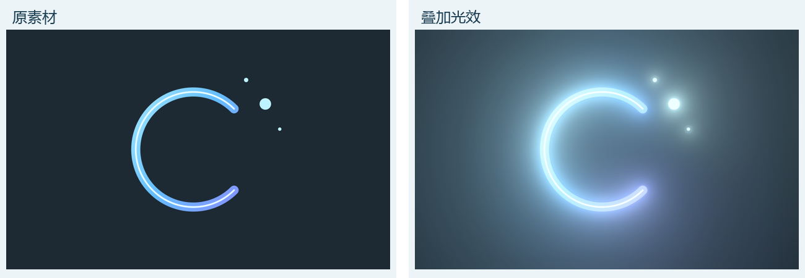
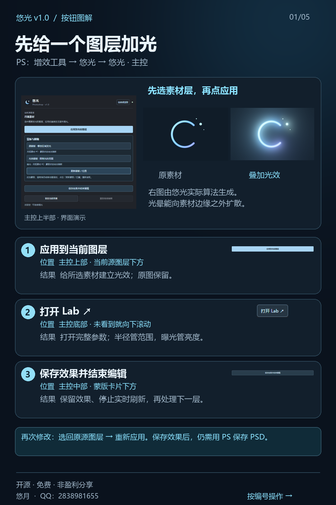
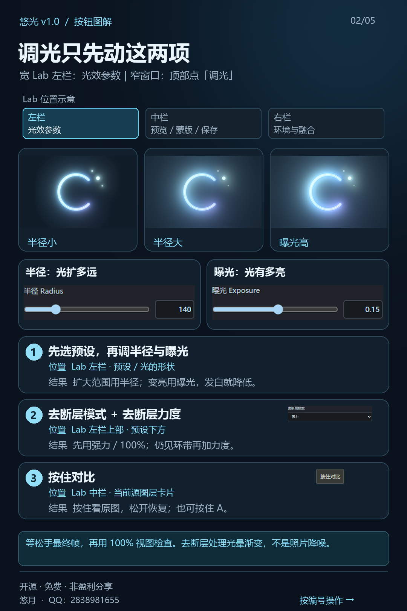
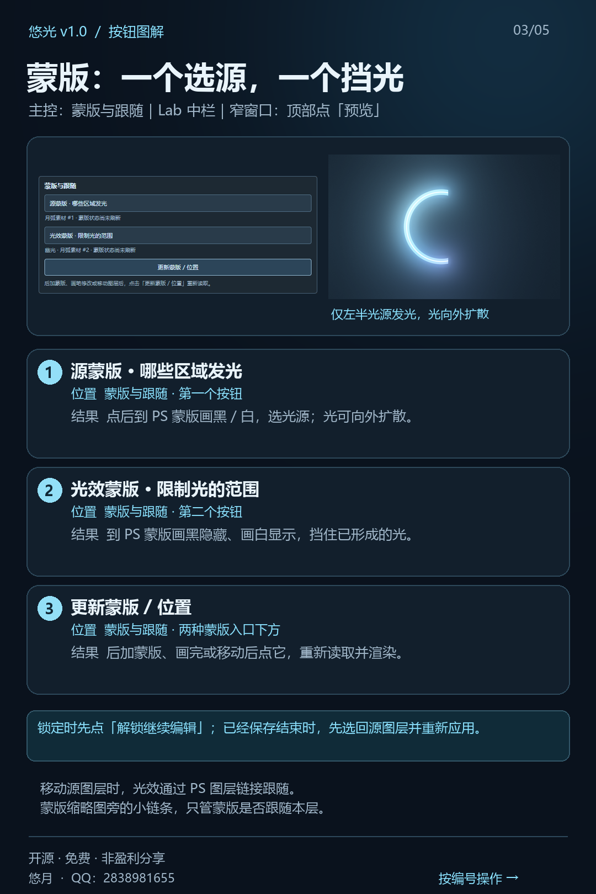
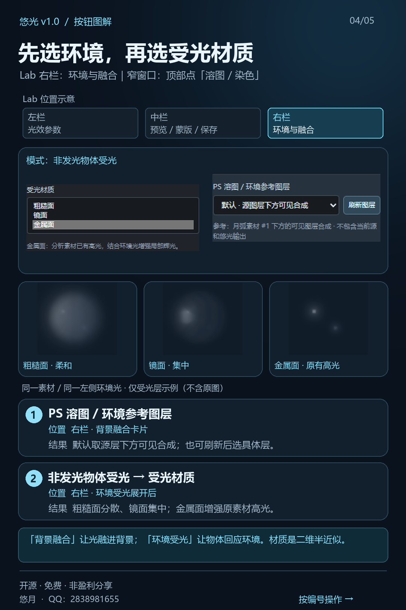
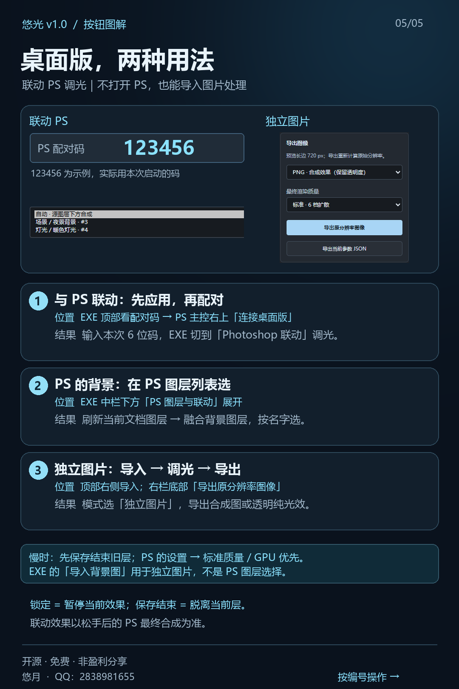
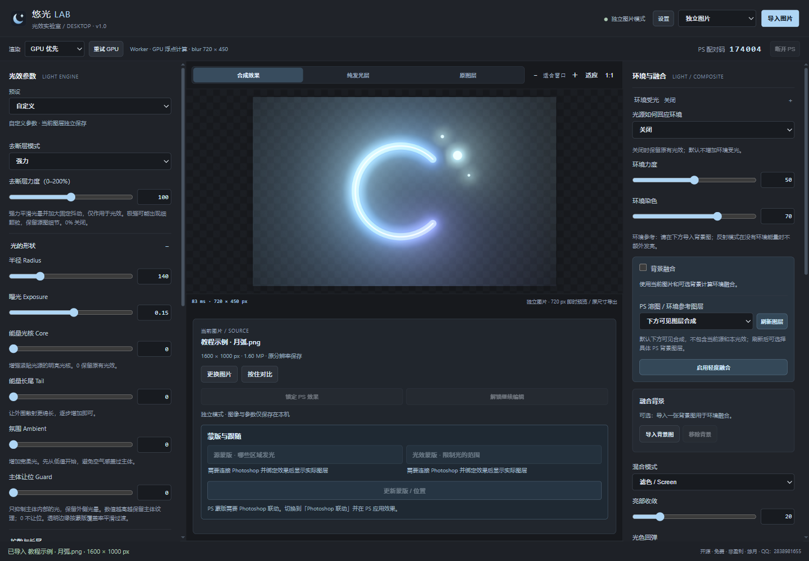

# 悠光 · yoglow

**给 Photoshop 单个图层加光，让调光留在创作里。**

Photoshop 图层光效 · DF 整图光学柔光 · 可展开 Lab 工作台

[下载 v1.1](https://github.com/Yunogengar/YouGuang/releases/latest) · [五张图快速上手](#五张图快速上手) · [反馈问题](https://github.com/Yunogengar/YouGuang/issues)

Windows x64 · Photoshop 2025 / 26.0 及以上 · 简体中文

悠光是一款面向修图、合成与视觉特效的图层光效工具。选中素材层，调整光晕范围、亮度与颜色，用蒙版控制发光位置；完成后保存效果并结束编辑，再处理下一个图层。

## v1.1 更新

- **DF 光学柔光**：整张可见画面的高光扩散与柔光叠加。主控底部「DF 光学柔光 ↗」，或 Lab 顶部「DF 柔光」进入。
- **四种 DF 预设**：轻柔扩散、高光漫射、暖色柔光、横向镜头微光；可调浓度、扩散范围、衰减、高光选择、色彩与质量。
- **独立滤镜层**：保存后停止实时刷新；选回 DF 层可继续编辑，也能叠加新 DF。底图改动后点击「刷新画面」。DF 当前支持不透明的整图画面，透明素材请使用单图层辉光。
- **GPU 与交互优化**：修复零强度触发 GPU 回退；只改浓度、辉光和颜色复用扩散缓存，小型 DF 预览减少一次传输往返。
- **更清楚的图层控制**：绑定检查、定位与修复，背景点选 / 框选取光、双光和色相 / 亮度 / 主体深度范围选择。

完整按钮说明见 [DF 光学柔光指引](optical-diffusion.html)；下载离线指南后用浏览器打开其中的 `optical-diffusion.html`。

## 下载与安装

前往 **[Releases 下载区](https://github.com/Yunogengar/YouGuang/releases/latest)**，下载 `yoglow-v1.1-Setup.exe`。

1. 保存 Photoshop 文档并退出 PS。
2. 运行安装程序，选择 **Photoshop 插件**、**桌面版**，或同时安装。
3. 重新打开 PS，从 **插件 → 悠光** 进入面板；桌面版从桌面快捷方式启动。

**只安装 PS 窗口版即可使用图层辉光与 DF，算法和整合包内的 PS 组件相同。** 轻量 ZIP 约 7.7 MB；桌面组件可选，本轮新增 DF 在 PS 面板内使用。

也可下载 `yoglow-v1.1-PS.zip`，完整解压后运行 `install.ps1`；常规 Program Files 安装可自动查找 PS，非标准路径请使用整合安装器。

## 30 秒开始调光

**选素材层 → 应用到当前图层 → 调半径与曝光 → 保存效果并结束编辑。**

| 想做什么 | 找哪个入口 | 会得到什么 |
| --- | --- | --- |
| 给一个物体加光 | 主面板「应用到当前图层」 | 建立该源图层的独立效果 |
| 调光晕范围和亮度 | 「半径」「曝光」 | 扩散更远或收紧，增强或减弱光效 |
| 在大窗口里调参数 | 「打开 Lab」「展开工作台 ↗」 | 可调整大小的完整工作台 |
| 只让局部发光 | 「源蒙版 · 哪些区域发光」 | 选择光源，光仍能向蒙版外扩散 |
| 挡住一部分光 | 「光效蒙版 · 限制光的范围」 | 控制生成后光晕的可见区域 |
| 后加蒙版或移动素材 | 「更新蒙版 / 位置」 | 重新读取蒙版与位置 |
| 做完后编辑下一层 | 「保存效果并结束编辑」 | 保留效果与参数，停止当前实时绑定 |

> 「保存效果并结束编辑」保存的是插件效果状态；文档仍需通过 Photoshop 保存为 PSD。再次应用到原素材层可继续编辑。

## 主要功能

| 模块 | 功能 |
| --- | --- |
| **图层光晕** | 半径、曝光、原图色彩响应与预设；光可越过素材边缘，在文档画布范围内扩散 |
| **去断层** | 自然、强力、极强模式与 0–200% 力度，改善 8 bit 光晕渐变的色阶环带 |
| **蒙版与跟随** | 区分源蒙版与光效蒙版，显示实际目标层；支持后加蒙版刷新、位置更新和源/效果图层关联 |
| **背景融合** | 默认参考源层下方的可见合成，也可按名称选择 PS 背景图层，调节光效与背景的融合 |
| **环境受光** | 自发光物体的环境调制，以及非发光物体的粗糙面、镜面、金属面受光响应 |
| **进阶控制** | 轮廓光、遮挡参考与多个绑定效果间的参数联动 |
| **编辑管理** | 锁定/解锁、启用开关、按住对比；保存结束后释放当前实时编辑 |
| **性能设置** | 自动 / GPU 优先 / CPU、重试 GPU、预览长边、质量、耗时诊断和缓存清理 |
| **桌面联动** | 通过同机配对码连接 PS，修改当前绑定源的参数并选择 PS 背景图层 |
| **独立图片处理** | 导入 PNG、JPEG、WebP 和背景图；导出原尺寸合成图、透明纯光效或参数 JSON |

### 三种材质怎么选

- **粗糙面**：较宽、柔和的环境受光，适合哑光表面。
- **镜面**：更集中、更锐利的高光响应。
- **金属面**：轻量模式参考已有亮部；空间受光模式按指定光源与估算表面形成带色高光。

环境受光由二维图像与参考背景估算。适合快速制作受光观感；效果受素材明暗、轮廓和参考背景影响。

## 性能与适用范围

RTX 5080、Photoshop 27.6、6000×4000 RGB 8 位自建测试图：DF 重建帧 623 ms，缓存调浓度 584 ms，连续拖动的 11 个中间帧中位数 282 ms（205–455 ms），松手最终帧 457 ms。最终代理为 1731×1154，拖动代理为 540×360。

数值包含算法与 PS 写回；首次读取、界面绘制、设备、图片与系统负载会影响整体响应，不代表所有图片都达到相同速度。GPU 负责浮点模糊，DF 颜色差输出仍在 WebView CPU 完成。两轮原生 DF 流程各 12 项检查通过。

环境受光为 2.5D 近似；单张图片无法恢复完整的三维材质或画外环境。可选深度模型需要另外安装，不包含在基础安装包中。

## 五张图快速上手

以下五张图为基础操作示意；v1.1 的 DF 新入口和最新参数请优先查看离线 HTML 指引。按顺序看，图中标注了对应按钮的位置与用途。可在 [Releases](https://github.com/Yunogengar/YouGuang/releases/latest) 下载 PDF，方便手机阅读与教学分享。

### 1. PS 起步与保存

**选素材 → 应用 → 打开 Lab → 调整 → 保存结束。**

### 2. 调光与去断层

**半径管范围，曝光管亮度；看到渐变环带，再逐步加去断层。**

### 3. 蒙版与位置

**源蒙版选光源，光效蒙版挡光；新增蒙版、绘制或移动后，点更新。**

### 4. 溶图与三种材质

**先选背景参考，再开启背景融合或环境受光。**

### 5. 桌面联动与独立导出

**联动：打开桌面版 → 在 PS 输入六位配对码 → 编辑当前绑定源。独立：导入图片 → 调光 → 导出。**

查看桌面工作台界面

操作图中的界面裁片来自当前界面的浏览器演示，PS/联动状态为模拟示例；效果对比由悠光算法生成。不同素材的实际表现会有所不同。

## 常见问题

**为什么选择 GPU 优先，状态里仍有 CPU？**  
GPU 优先表示计算偏好。模糊可使用 GPU，读取 PS 图层、部分处理与写回合成仍可能经过 CPU。设置中的实际后端与分段耗时可用于定位；GPU 不可用时可点击「重试 GPU」。

**大画布会全部参与发光计算吗？**  
普通光效按源图层及所需扩散范围处理，扩散受文档画布限制。背景融合、环境参考、较大半径与精细质量会增加处理量。

**8 bit 还有环带怎么办？**  
从「自然」和较低力度起步，按需要增加到「强力 / 极强」。去断层会引入细微抖动，较强设置可能看见细颗粒，适合结合实际输出尺寸检查。

**新增蒙版后没有变化？**  
确认当前源图层名称，点击「更新蒙版 / 位置」。已结束编辑时，先重新应用到原素材层。

**怎样暂停调光，又保留当前结果？**  
暂时停住用「锁定当前效果」，恢复用「解锁继续编辑」。完成该层用「保存效果并结束编辑」，之后可手动开关效果图层，再处理下一层。

**桌面版为什么选不到 PS 图层？**  
确认已切到「Photoshop 联动」、完成配对，并在 PS 面板应用到一个素材层。展开「PS 图层与联动」后点击「刷新当前文档图层」。独立模式读取的是本机图片。

## 问题反馈

欢迎在 [Issues](https://github.com/Yunogengar/YouGuang/issues) 提交问题或建议。为了方便复现，请尽量附上：

- 悠光版本、Windows 与 Photoshop 版本。
- 出现问题时点击的按钮，以及预期和实际结果。
- 画布和素材层尺寸、渲染质量、后端状态与耗时。
- 不含私人内容的截图；不要上传未脱敏的作品或日志。

## 作者

**悠月** · GitHub [@Yunogengar](https://github.com/Yunogengar) · QQ：**2838981655**

悠光 v1.1 · 免费、非盈利分享。
